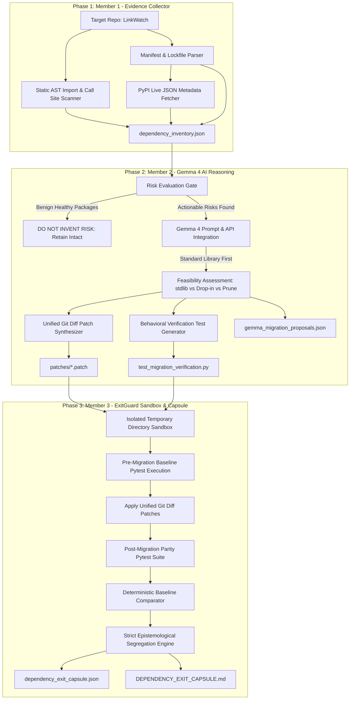

# 🛡️ Resilify: AI-Assisted Dependency Resilience & Exit Capsule Engine

[](#)
[](#)
[-orange.svg)](#)
[](LICENSE)
[](#)

> **Hacktoberfest Track 1 Submission:** Gemma 4 Dependency Resilience  
> **Team:** Team ImpactForge  
> **Target Repository:** [`https://github.com/rishrek/LinkWatch`](https://github.com/rishrek/LinkWatch)

---

## 1. Problem and Solution Overview

### The Problem: Open-Source Dependency Decay
Modern Python ecosystems move quickly, but application codebases frequently suffer from silent dependency rot. In production projects, libraries become unmaintained, upstream APIs introduce breaking changes, and runtime incompatibilities emerge as developers upgrade to modern Python versions (Python 3.12 and 3.13):
- Legacy serialization libraries like `toml` lack active maintenance since 2020 while standard library replacements like `tomllib` are now built-in.
- Abandoned configuration paths like `appdirs` fail to adhere to modern operating system cache and data standards.
- Obsolete package utilities like `pkg_resources` produce loud deprecation warnings and performance degradation.
- Ghost dependencies (declared packages never actually imported) inflate installation overhead and security attack surfaces.
- Version specification conflicts across `requirements.txt` and `pyproject.toml` block automated CI/CD pipelines.

### The Solution: Resilify
**Resilify** is an enterprise-grade, evidence-backed AI dependency resilience and migration pipeline designed specifically for Python 3.12 and 3.13. 

Rather than relying on ungrounded AI assumptions, Resilify operates with strict epistemological boundaries:
1. **Member 1 (Static Analysis & Evidence Collection):** Parses lockfiles/manifests, extracts pinned versions, audits live PyPI release dates/classifiers, and scans Abstract Syntax Trees (AST) for genuine call sites and contexts.
2. **Member 2 (Gemma 4 AI Reasoning & Migration Synthesis):** Enforces the core mandate *"Do not invent risk"*. Benign packages remain untouched. For genuinely actionable dependencies, Gemma 4 synthesizes standard-library-first migrations, active drop-in replacements, mathematically clean unified git diff patches, and behavioral verification tests.
3. **Member 3 (Sandboxed Verification & Dependency Exit Capsule):** Executes all proposed migrations inside isolated, disposable sandbox directories, verifies pre-existing baseline behaviors, executes post-migration test suites, and outputs the definitive **Dependency Exit Capsule** (`dependency_exit_capsule.json` and `DEPENDENCY_EXIT_CAPSULE.md`).

---

## 2. Setup Instructions

### Prerequisites
- Python 3.12 or 3.13 installed
- Git installed and configured
- Google AI Studio API key (for live Gemma 4 inference)

### Installation

```bash
# 1. Clone the repository
git clone https://github.com/OmkarD09/H26_ImpactForge_Resilify.git
cd H26_ImpactForge_Resilify

# 2. Create and activate a virtual environment
python -m venv .venv
# On Windows:
.venv\Scripts\activate
# On Linux/macOS:
source .venv/bin/activate

# 3. Install dependencies
pip install -r requirements.txt

# 4. Configure your Google AI Studio API Key
# Create a .env file (automatically ignored by git):
echo GEMINI_API_KEY="your_google_ai_studio_api_key_here" > .env
echo GOOGLE_API_KEY="your_google_ai_studio_api_key_here" >> .env
```

---

## 3. Usage Instructions

Resilify provides clear CLI commands to execute each phase of the dependency resilience lifecycle:

```bash
# Phase 1: Collect static inventory & AST usage evidence (Member 1)
python -m resilify.collector

# Phase 2: Run Gemma 4 AI reasoning and patch synthesis (Member 2)
python -m resilify.gemma_orchestrator

# Phase 3: Execute isolated sandboxed test runner & generate Dependency Exit Capsule (Member 3)
python -m resilify.sandbox_runner
python -m resilify.capsule_generator

# Verify entire test suite (Reasoners, Sandboxes, Schemas, Parity Tests)
python -m pytest tests/ -v
python -m pytest tests_exitguard/ -v
python -m pytest LinkWatch/tests/ -v
```

---

## 4. Architecture

Resilify strictly segregates **Observed & Verified Ground Truth** from **AI Hypotheses and Recommendations**.



---

## 5. Dependencies

The Resilify pipeline relies on modern, audited runtime packages:

| Dependency | Purpose |
| :--- | :--- |
| `google-genai` | Official Google GenAI SDK for live Gemma 4 model inference |
| `pydantic` | Data contract validation, configuration parsing, and schema schemas |
| `pytest` | Test execution, baseline evaluation, and sandbox regression detection |
| `pytest-asyncio` | Async test fixtures and subprocess management |
| `platformdirs` | Drop-in modern OS cache and data directory resolution (replaces `appdirs`) |
| `rich` | Terminal visualization, structured logging, and console formatting |
| `httpx` / `requests` | Network communication and PyPI live metadata harvesting |
| `packaging` | SemVer parsing, version specifier checking, and range evaluations |
| `python-dotenv` | Secure local credential management without committing keys |

---

## 6. AI Model Details

- **Model Name:** Gemma 4
- **Model Version / Identifier:** `gemma-4-26b-a4b-it` (with failover support to `gemma-4-31b-it`)
- **Model Source:** Google DeepMind / Google AI Studio
- **Access Method:** Google Gemini API via the official `@google/genai` (v2.22.0) Python SDK with `api_version="v1alpha"`
- **Model License:** Apache-2.0
- **Role of the Model in Resilify:**
  - Analyzes grounded AST call sites, manifest version conflicts, and PyPI deprecation markers without fabricating unverified risk.
  - Prioritizes modern Python 3.11+ built-in standard library solutions (e.g., migrating `toml` to `tomllib` with binary read mode `'rb'`).
  - Recommends active community drop-in replacements for abandoned libraries (e.g., `appdirs` to `platformdirs`).
  - Identifies obsolete testing tools (e.g., `nose`) and unreferenced ghost dependencies (e.g., `six`) for removal.
  - Synthesizes exact unified git diff patches and drafts behavior-preserving pytest verification suites.

---

## 7. Known Limitations & Engineering Disclosures

In accordance with strict engineering integrity standards, Resilify explicitly documents the following boundaries:

1. **Dynamic Imports & Metaprogramming:** Static AST analysis inspects all standard `import` and `from ... import` statements. Dynamic runtime imports (`importlib.import_module` with variable strings or runtime `__import__`) are not guaranteed to be detected without dynamic tracing.
2. **Standard Library `tomllib` Read-Only Scope:** Python's built-in `tomllib` is strictly a TOML parser and does not provide TOML writing/serialization capabilities. Applications requiring TOML write operations must use `tomli-w` or alternative serializers.
3. **Pydantic v1 vs v2 Deprecation Warnings:** While the synthesized migration maintains backward-compatible `@validator` execution under Pydantic v2, deprecation warnings are emitted by Pydantic. Long-term refactoring should incrementally adopt `@field_validator`.
4. **Offline CI Network Isolation:** In completely air-gapped CI environments where external PyPI HTTP queries are disabled, Resilify leverages local caching (`.pypi_cache.json`) and deterministic offline expert synthesis to guarantee reproducible builds.

---

## 8. License

This project is licensed under the **Apache License, Version 2.0**. See the [LICENSE](LICENSE) file for complete details.

Copyright © 2026 Team ImpactForge.
