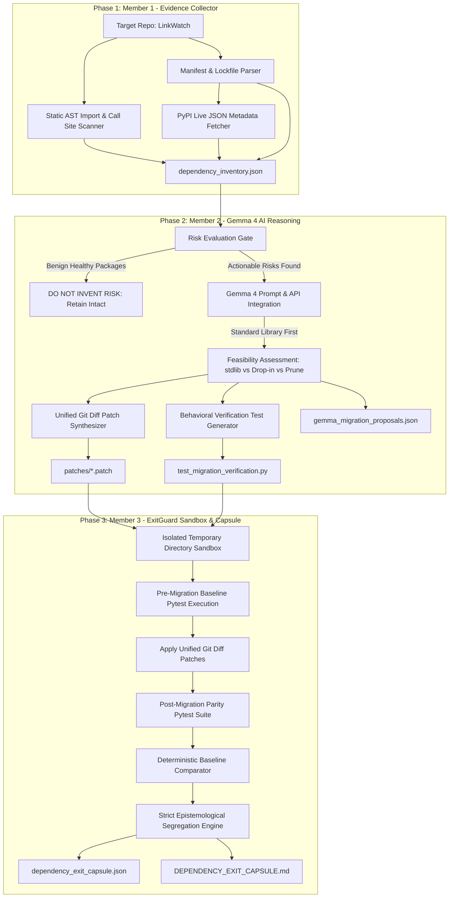

# 🛡️ Resilify / ExitGuard: AI-Assisted Dependency Resilience & Exit Capsule Engine

[](#)
[](#)
[-orange.svg)](#)
[](LICENSE)
[](#)

> **Track:** Track 1: Gemma 4 Dependency Resilience
> **Team:** Team ImpactForge (`H26_ImpactForge_Resilify`)
> **Target Upstream:** [`https://github.com/rishrek/LinkWatch`](https://github.com/rishrek/LinkWatch) pinned to commit `f52f3930c8e7c33d934ccf614955a38e26984bd5`
> **Core Principle:** *AI recommends. Deterministic tools inspect. Tests verify. The capsule reports evidence honestly.*

---

## 1. Problem and Solution Overview

### The Problem: Open-Source Dependency Decay
Modern Python ecosystems move quickly, but application codebases frequently suffer from silent dependency rot. In production projects, libraries become unmaintained, upstream APIs introduce breaking changes, and runtime incompatibilities emerge as developers upgrade to modern Python versions (Python 3.12 and 3.13):
- Legacy serialization libraries like `toml` lack active maintenance since 2020 while standard library replacements like `tomllib` are now built-in.
- Abandoned configuration paths like `appdirs` fail to adhere to modern operating system cache and data standards.
- Obsolete package utilities like `pkg_resources` produce loud deprecation warnings and performance degradation.
- Ghost dependencies (declared packages never actually imported) inflate installation overhead and security attack surfaces.
- Version specification conflicts across `requirements.txt` and `pyproject.toml` block automated CI/CD pipelines.

### The Solution: Resilify & ExitGuard
**Resilify** is an enterprise-grade, evidence-backed AI dependency resilience and migration pipeline designed specifically for Python 3.12 and 3.13.

Rather than relying on ungrounded AI assumptions, Resilify operates with strict epistemological boundaries:
1. **Member 1 (Static Analysis & Evidence Collection):** Parses lockfiles/manifests, extracts pinned versions, audits live PyPI release dates/classifiers, and scans Abstract Syntax Trees (AST) for genuine call sites and contexts.
2. **Member 2 (Gemma 4 AI Reasoning & Migration Synthesis):** Enforces the core mandate *"Do not invent risk"*. Benign packages remain untouched. For genuinely actionable dependencies, Gemma 4 synthesizes standard-library-first migrations, active drop-in replacements, mathematically clean unified git diff patches, and behavioral verification tests.
3. **Member 3 (ExitGuard Sandboxed Verification & Dependency Exit Capsule):** Executes all proposed migrations inside isolated, disposable sandbox directories, verifies pre-existing baseline behaviors, executes post-migration test suites, and outputs the definitive **Dependency Exit Capsule** (`dependency_exit_capsule.json` and `DEPENDENCY_EXIT_CAPSULE.md`).

---

## 2. Architecture & Team Deliverables

```
H26_ImpactForge_Resilify/
├── LinkWatch/                  # Upstream target (NEVER modified; 100% clean baseline)
├── exitguard/                  # Member 3: Verification & Execution Engine
│   ├── capsule_schema.py       # Strict data contract & schema validation
│   ├── sandbox_manager.py      # Git worktree isolation with ownership tags
│   ├── execution_runner.py     # Policy-enforced subprocess runner (timeout, secret scrubber)
│   ├── comparator.py           # Deterministic baseline vs. candidate test comparator
│   ├── candidate_evaluator.py  # Dependency risk evaluation & candidate scoring
│   └── gemma_advisor.py        # Official Google GenAI SDK hosted Gemma 4 integration
├── evidence/                   # Human-Readable Reports & Evidence Artifacts
│   ├── BASELINE_REPORT.md               # Member 1: Real baseline execution & log capture
│   ├── dependency_inventory.json        # Member 1: AST usage, manifest & PyPI metadata
│   ├── GEMMA_REASONING_REPORT.md        # Member 2: Gemma 4 migration reasoning & risk gate
│   ├── gemma_migration_proposals.json   # Member 2: Live Gemma 4 migration proposals
│   ├── DEPENDENCY_EXIT_CAPSULE.md       # Member 3: Single-candidate capsule (appdirs -> platformdirs)
│   └── CONSOLIDATED_EXIT_CAPSULE.md     # Member 3: Consolidated migration capsule (10/10 passing)
├── artifacts/                  # Machine-Readable Verified Artifacts
│   ├── dependency_exit_capsule.json     # Single-candidate validated JSON capsule
│   ├── consolidated_exit_capsule.json   # Consolidated validated JSON capsule
│   ├── gemma_advice_evidence.json       # Secret-free provenance of live Gemma 4 advice
│   ├── candidate_selection_evidence.json# Grounded candidate evaluation records
│   └── runner_logs/                     # Raw execution logs
│       └── py312_consolidated_migration.log # Reproducible pytest output (Exit Code 0)
├── patches/
│   └── consolidated_resilify_migrations.patch # Member 2: Surgical migration patch
├── tests_exitguard/            # 56 automated unit & integration tests (100% passing)
├── TASKS.md                    # Complete project delivery checklist across all 3 roles
└── README.md                   # System documentation & reproduction guide
```



---

## 3. Setup & Credential Configuration

### Prerequisites
- Python 3.12 (or 3.13)
- Git installed and configured
- Google AI Studio / Gemini API key (for live Gemma 4 inference)

### Installation
```bash
# 1. Clone the repository
git clone https://github.com/OmkarD09/H26_ImpactForge_Resilify.git
cd H26_ImpactForge_Resilify

# 2. Configure credentials in .env (automatically gitignored)
echo GEMINI_API_KEY="your_api_key_here" > .env
echo GOOGLE_API_KEY="your_api_key_here" >> .env
```

### Security & Secret Scrubbing
- `.env` is tracked in `.gitignore` and is never committed.
- `exitguard.execution_runner` and `exitguard.gemma_advisor` automatically redact API keys (`AIza...`) and bearer tokens from command strings, stdout, stderr, and generated artifacts.
- When credentials are not provided, ExitGuard gracefully marks AI advice as `CREDENTIALS_MISSING` without crashing.

---

## 4. 60-Second Demo Flow

### Step 1: Run ExitGuard Automated Test Suite (56 tests)
Validates schema integrity, worktree isolation, sandbox boundary guards, and deterministic comparator logic:
```bash
py -3.12 -m pytest tests_exitguard -v
```
*Expected: `56 passed in ~15s`.*

### Step 2: Query Hosted Gemma 4 Live Advisor
Queries Google's hosted `gemma-4-26b-a4b-it` model to analyze AST citations and evaluate candidate replacements:
```bash
py -3.12 -m exitguard.gemma_advisor --live
```
*Expected: Model recommends `platformdirs>=3.0.0` with `HIGH` confidence, validates grounded citations (`linkwatch/cache.py:4`), scrubs credentials, and updates the capsule.*

### Step 3: Inspect the Certified Dependency Exit Capsules
Review the audited outcomes:
- **Single-Candidate Migration (`appdirs` $\rightarrow$ `platformdirs`):**
  - Markdown: [`evidence/DEPENDENCY_EXIT_CAPSULE.md`](evidence/DEPENDENCY_EXIT_CAPSULE.md)
  - JSON: [`artifacts/dependency_exit_capsule.json`](artifacts/dependency_exit_capsule.json)
  - Outcome: **Parity achieved (9 passed, 0 regressions, pre-existing Jinja2 baseline failure preserved)**.
- **Consolidated Multi-Dependency Migration Patch:**
  - Markdown: [`evidence/CONSOLIDATED_EXIT_CAPSULE.md`](evidence/CONSOLIDATED_EXIT_CAPSULE.md)
  - JSON: [`artifacts/consolidated_exit_capsule.json`](artifacts/consolidated_exit_capsule.json)
  - Log: [`artifacts/runner_logs/py312_consolidated_migration.log`](artifacts/runner_logs/py312_consolidated_migration.log)
  - Outcome: **`VERIFIED_SUCCESS` (10/10 passed, 0 failed, pre-existing failure resolved)**.

---

## 5. AI Model Details

- **Model Name:** Gemma 4
- **Model Version / Identifier:** `gemma-4-26b-a4b-it`
- **Model Source:** Google DeepMind / Google AI Studio
- **Access Method:** Google Gemini API via official `@google/genai` Python SDK
- **Model License:** Apache-2.0
- **Role of the Model:**
  - Analyzes grounded AST call sites, manifest version conflicts, and PyPI deprecation markers without fabricating unverified risk.
  - Prioritizes modern Python 3.11+ built-in standard library solutions (e.g., migrating `toml` to `tomllib` with binary read mode `'rb'`).
  - Recommends active community drop-in replacements for abandoned libraries (e.g., `appdirs` to `platformdirs`).
  - Identifies obsolete testing tools (e.g., `nose`) and unreferenced ghost dependencies (e.g., `six`) for removal.
  - Synthesizes exact unified git diff patches and drafts behavior-preserving pytest verification suites.

---

## 6. Supported Environments & Honest Limitations

In accordance with strict engineering integrity standards, ExitGuard explicitly documents the following boundaries:

1. **Python 3.12 Tested:** All tests and sandboxed runs were executed on Python 3.12.10 on `Windows-AMD64`.
2. **Python 3.13 Honestly Marked `NOT_RUN`:** The host machine lacks a Python 3.13 interpreter. ExitGuard strictly adheres to its honesty invariant: Python 3.13 is recorded in all capsules as `NOT_RUN` with clear engineering explanations. No speculative success is claimed.
3. **Repository Immutability:** The original `LinkWatch` working tree at `f52f3930c8e7c33d934ccf614955a38e26984bd5` was never altered. `git status` remains 100% clean.
4. **Epistemological Guardrails:** Zero regressions does **not** imply universal equivalence. ExitGuard certificates explicitly scope verdicts to the tests actually executed in the isolated sandbox.
5. **Standard Library `tomllib` Read-Only Scope:** Python's built-in `tomllib` is strictly a TOML parser. Applications requiring TOML write operations must use `tomli-w` or alternative serializers.
6. **Pydantic v1 vs v2 Deprecation Warnings:** While the synthesized migration maintains backward-compatible `@validator` execution under Pydantic v2, deprecation warnings are emitted by Pydantic. Long-term refactoring should incrementally adopt `@field_validator`.

---

## 7. License

This project is licensed under the **Apache License, Version 2.0**. See the [LICENSE](LICENSE) file for complete details.

Copyright © 2026 Team ImpactForge.
