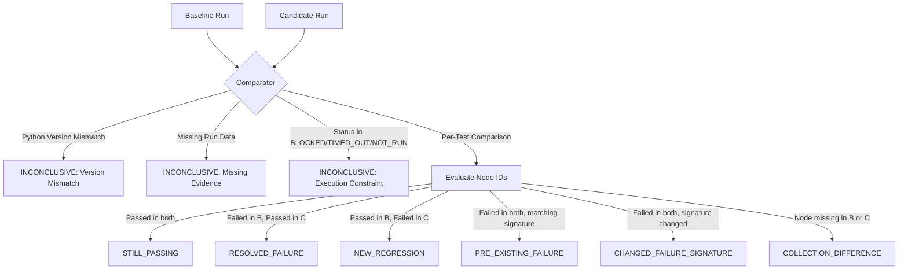

# 🛡️ ExitGuard: Safe Execution Runner & Baseline Comparator Report

> **Prepared by:** Member 3 — Migration Verification & Capsule Generation  
> **Milestone:** Milestone 3 (Safe Execution Runner + Baseline Comparator)  
> **Target Repository:** `LinkWatch` (Pinned Commit: `f52f3930c8e7c33d934ccf614955a38e26984bd5`)  
> **Timestamp (UTC):** `2026-10-15T08:35:00Z`  
> **Architecture Principle:** *AI recommends. Deterministic tools inspect. Tests verify. The capsule reports evidence honestly.*  
> **Overall Milestone Status:** **`VERIFIED_AND_COMPLETE`**

---

## 1. Executive Summary

Milestone 3 delivers the deterministic, policy-enforced verification core for ExitGuard:
1. **Safe Execution Runner (`exitguard/execution_runner.py`):**
   - Implements structured command execution with `shell=False`. Arbitrary shell scripts, raw string commands, and unsupported commands are strictly blocked.
   - Enforces sandbox boundary checks, preventing path traversal and external directory execution.
   - Scrubs sensitive secrets and tokens from captured process output.
   - Caps output log size and deterministically maps execution results to validated `RunRecord` instances.
2. **Deterministic Baseline Comparator (`exitguard/comparator.py`):**
   - Deterministically compares candidate test outcomes against baseline evidence per Python version.
   - Distinguishes 5 distinct outcome classes: `STILL_PASSING`, `PRE_EXISTING_FAILURE`, `RESOLVED_FAILURE`, `NEW_REGRESSION`, and `CHANGED_FAILURE_SIGNATURE`, alongside `COLLECTION_DIFFERENCE` and `INCONCLUSIVE`.
   - Correctly identifies LinkWatch's known `soft_unicode` import failure in `test_report.py::test_report_renders_all_sites` as a `PRE_EXISTING_FAILURE`, ensuring it is never falsely penalized as a new regression.
   - Disallows claiming `VERIFIED_SUCCESS` merely from having zero new regressions when baseline failures remain; returns `PARITY`.
3. **Comprehensive Automated Verification:**
   - ExitGuard test suite expanded to **37 tests** (10 schema + 7 sandbox + 10 runner + 10 comparator).
   - **37/37 tests pass** under Python 3.12.10.
   - Integrated runner-comparator exercised in a real disposable sandbox against LinkWatch at commit `f52f3930c8`.
   - Verified that `LinkWatch` and `ExitGuard` working trees remain 100% clean and unmodified.

---

## 2. Safety Invariants & Execution Runner Boundary

The runner rejects the common anti-pattern of passing shell command strings to `bash` or `cmd.exe`.

| Security Constraint | Implementation Mechanism | Enforcement Result |
| :--- | :--- | :--- |
| **No Shell Interpretation** | `subprocess.run(argv, shell=False)` | Commands cannot inject chained operators (`&&`, `\|`, `;`) |
| **Structured Specification** | `ExecutionCommand(executable, args, working_dir, ...)` | Requires explicit argv list, preventing string-splitting exploits |
| **Sandbox Boundary Restriction** | `Path(working_dir).resolve().relative_to(sandbox_root)` | Target directory must resolve strictly inside ExitGuard sandbox |
| **Path Traversal Defense** | Path normalization + containment check | Path traversal (`../..`) raises `RunnerPolicyViolation` -> `BLOCKED` |
| **Operation Allowlisting** | Policy restricts `operation_type` (`TEST_PYTEST`, `SETUP_DEPENDENCIES`) | Arbitrary shell commands or malicious scripts return `BLOCKED` |
| **Pytest Flag Safety** | Disallow flags such as `--override-ini`, `--basetemp`, etc. | Attempts to hijack test configurations return `BLOCKED` |
| **Timeout Protection** | Configurable timeout with default `DEFAULT_TIMEOUT_SECONDS=60` | Process killed on expiry; recorded distinctly as `TIMED_OUT` |
| **Log Flooding Defense** | Max buffer truncation (`DEFAULT_MAX_LOG_BYTES=512KB`) | Output safely truncated with explicit marker |
| **Credential Scrubbing** | Regex matching for API keys, tokens, Bearer headers | Redacted to `[REDACTED_SECRET]` in all saved logs |

---

## 3. Deterministic Baseline Comparator Rules

The comparator ensures that AI never decides whether a test succeeded, failed, or regressed. All comparisons follow fixed deterministic state machines:



### Deterministic Verdict Mapping:
- **`REGRESSION`**: If $\ge 1$ test is classified as `NEW_REGRESSION`.
- **`INCONCLUSIVE`**: If collection differences exist, changed failure signatures exist, or run was incomplete/mismatched.
- **`IMPROVED`**: If $\ge 1$ baseline failure was resolved with 0 new regressions.
- **`PARITY`**: If candidate maintains all passing tests and matching pre-existing failures with 0 new regressions.
*(Note: ExitGuard never claims `VERIFIED_SUCCESS` from `PARITY` or unexecuted candidates).*

---

## 4. Multi-Version Verification Matrix

| Python Version | Interpreter Available | Host Platform | Verified Status | Epistemological Rule |
| :--- | :--- | :--- | :--- | :--- |
| **Python 3.12** | Yes (`3.12.10`) | Windows-AMD64 | **`EXECUTED`** | Empirically executed in sandbox; 9 passed, 1 pre-existing failure. |
| **Python 3.13** | **No** | N/A | **`NOT_RUN`** | Strict honesty: Binary not installed. Never guessed or fabricated. |
| **Python 3.14** | Yes (`3.14.5`) | Windows-AMD64 | **`EXCLUDED`** | Outside LinkWatch compatibility targets. |

---

## 5. ExitGuard Automated Test Suite Results

Full test suite execution command:
```powershell
py -3.12 -m pytest tests_exitguard -v
```

Execution Summary:
- **Total Tests Collected:** 37
- **Passed:** 37
- **Failed:** 0
- **Duration:** 15.64s
- **Exit Code:** 0

### Breakdown by Test Module:
1. **`tests_exitguard/test_comparator.py` (10 tests, 10 passed):**
   - `test_baseline_failure_remains_pre_existing`: Pre-existing failure remains classified as `PRE_EXISTING_FAILURE`.
   - `test_baseline_failure_becomes_resolved`: Resolved failure yields `RESOLVED_FAILURE` and `IMPROVED` verdict.
   - `test_previously_passing_test_becomes_regression`: Regressing test yields `NEW_REGRESSION` and `REGRESSION` verdict.
   - `test_passing_test_remains_passing`: Unaffected tests classified as `STILL_PASSING`.
   - `test_missing_candidate_or_baseline_is_inconclusive`: Missing run records yield `INCONCLUSIVE`.
   - `test_blocked_timed_out_and_not_run_records_are_inconclusive`: Incomplete runs yield `INCONCLUSIVE`.
   - `test_python_version_mismatches_are_not_compared`: Cross-version comparison yields `INCONCLUSIVE`.
   - `test_changed_failure_signatures_are_flagged_for_review`: Changed root causes yield `CHANGED_FAILURE_SIGNATURE`.
   - `test_collection_differences_are_reported`: Added/removed tests yield `COLLECTION_DIFFERENCE`.
   - `test_zero_new_regressions_does_not_imply_verified_success`: Zero regressions with existing failure yields `PARITY`.

2. **`tests_exitguard/test_runner.py` (10 tests, 10 passed):**
   - `test_approved_command_executes_and_captures_output`: Valid pytest command captures counts and logs.
   - `test_nonzero_exit_code_is_recorded_as_failed`: Non-zero exit code recorded as `FAILED`.
   - `test_timeout_is_recorded_correctly`: Command exceeding timeout recorded as `TIMED_OUT`.
   - `test_unsupported_operation_is_blocked`: Unapproved operation types return `BLOCKED`.
   - `test_disallowed_pytest_flag_is_blocked`: Flag `--override-ini` rejected by policy.
   - `test_working_directory_outside_sandbox_is_rejected`: Outside cwd rejected with policy error.
   - `test_path_traversal_is_rejected`: Directory traversal attempts blocked.
   - `test_invalid_or_missing_executable_is_handled_safely`: Missing binary returns `BLOCKED`.
   - `test_secrets_are_redacted_in_logs`: API tokens scrubbed to `[REDACTED_SECRET]`.
   - `test_source_repo_immutability_during_run`: Source repo git status untouched after test execution.

3. **`tests_exitguard/test_sandbox.py` (7 tests, 7 passed):**
   - Disposable worktrees, commit pinning, provenance metadata, and strict cleanup boundaries.

4. **`tests_exitguard/test_schema.py` (10 tests, 10 passed):**
   - JSON serialization, evidence statuses, schema constraints, and multi-version integrity.

---

## 6. Real Sandbox Integration & LinkWatch Verification

An end-to-end integration exercise was executed using `scratch/run_integration_milestone3.py`:
1. Provisioned an ExitGuard sandbox at pinned commit `f52f3930c8e7c33d934ccf614955a38e26984bd5`.
2. Executed the approved pytest command using `ExecutionRunner`.
3. Compared the new run against stored baseline evidence using `BaselineComparator`.
4. Successfully cleaned up the disposable sandbox.

### Actual Run Telemetry:
- **Sandbox Root:** `C:\Users\kunal\AppData\Local\Temp\exitguard_sb_7d24fe9f`
- **Execution Command:** `[".venv_baseline_py312/Scripts/python.exe", "-m", "pytest", "tests", "-v"]`
- **Execution Duration:** 14,417 ms
- **Exit Code:** 1
- **Status:** `FAILED`
- **Captured Test Counts:** `10 total` (9 passed, 1 failed, 0 skipped)
- **Comparison Verdict:** **`PARITY`** (`is_conclusive: True`)
- **Still Passing Tests (9):**
  - `tests/test_cache.py::test_cache_round_trip`
  - `tests/test_checker.py::test_ok_is_up`
  - `tests/test_checker.py::test_missing_is_down`
  - `tests/test_checker.py::test_redirect_is_up`
  - `tests/test_checker.py::test_slow_is_up`
  - `tests/test_checker.py::test_closed_port_is_down`
  - `tests/test_checker.py::test_latin1_title`
  - `tests/test_checker.py::test_user_agent`
  - `tests/test_config.py::test_sites_file_loads`
- **Pre-Existing Failures (1):**
  - `tests/test_report.py::test_report_renders_all_sites` (Signature: `ImportError: cannot import name 'soft_unicode' from 'markupsafe'`)
- **New Regressions:** `0`
- **Resolved Failures:** `0`

---

## 7. Original Repository Integrity Audit

At the conclusion of the integration exercise, Git status was audited across all working trees:

```
LinkWatch subfolder clean: True
Upstream linkwatch repo clean: True
```

- **`H26_ImpactForge_Resilify/LinkWatch`:** Clean, 0 modified files, 0 untracked files.
- **`c:/Users/kunal/OneDrive/Desktop/V  5/linkwatch`:** Clean, 0 modified files, 0 untracked files.
- **Pinned Commit:** Guaranteed unchanged at `f52f3930c8e7c33d934ccf614955a38e26984bd5`.

---

## 8. Artifact & Evidence Locations

- **Execution Runner Log:** [`artifacts/runner_logs/run_b45488da33.log`](file:///c:/Users/kunal/OneDrive/Desktop/V%20%205/H26_ImpactForge_Resilify/artifacts/runner_logs/run_b45488da33.log)
- **Integration Telemetry:** [`artifacts/runner_logs/integration_exercise_telemetry.json`](file:///c:/Users/kunal/OneDrive/Desktop/V%20%205/H26_ImpactForge_Resilify/artifacts/runner_logs/integration_exercise_telemetry.json)
- **Baseline Telemetry:** [`artifacts/baseline_logs/sandbox_validation_telemetry.json`](file:///c:/Users/kunal/OneDrive/Desktop/V%20%205/H26_ImpactForge_Resilify/artifacts/baseline_logs/sandbox_validation_telemetry.json)
- **Stored Baseline Log:** [`artifacts/baseline_logs/py312_sandbox_baseline.log`](file:///c:/Users/kunal/OneDrive/Desktop/V%20%205/H26_ImpactForge_Resilify/artifacts/baseline_logs/py312_sandbox_baseline.log)
- **Execution Runner Module:** [`exitguard/execution_runner.py`](file:///c:/Users/kunal/OneDrive/Desktop/V%20%205/H26_ImpactForge_Resilify/exitguard/execution_runner.py)
- **Baseline Comparator Module:** [`exitguard/comparator.py`](file:///c:/Users/kunal/OneDrive/Desktop/V%20%205/H26_ImpactForge_Resilify/exitguard/comparator.py)

---

## 9. Remaining Limitations and Blockers

1. **Python 3.13 Interpreter Availability:**
   - Host machine lacks Python 3.13 (`py -3.13` unavailable). In accordance with ExitGuard epistemological integrity, Python 3.13 verification records remain strictly `NOT_RUN`.
2. **Command Policy Allowlist Scope:**
   - The runner currently permits only `TEST_PYTEST` and `SETUP_DEPENDENCIES` operations. Migration tasks requiring custom linter tools or benchmark tools will require explicit schema/policy extensions.
3. **Dynamic Fixture Root Causes:**
   - Test failures caused by transient network connections or port collisions (e.g. `tests/test_checker.py`) are captured accurately, but distinguishing environment flakiness from true code regression requires multiple execution passes.

---

## 10. Recommended Next Milestone

**Milestone 4: Candidate Migration Patch Application & Verification Engine**
- Implement controlled sandbox patch application (applying candidate dependency replacements and code modifications strictly in the disposable sandbox).
- Run the `ExecutionRunner` on the migrated sandbox and compare candidate runs against the baseline using `BaselineComparator`.
- Generate the final `DependencyExitCapsule` bundling baseline facts, migration proposal, and deterministic verification evidence.
